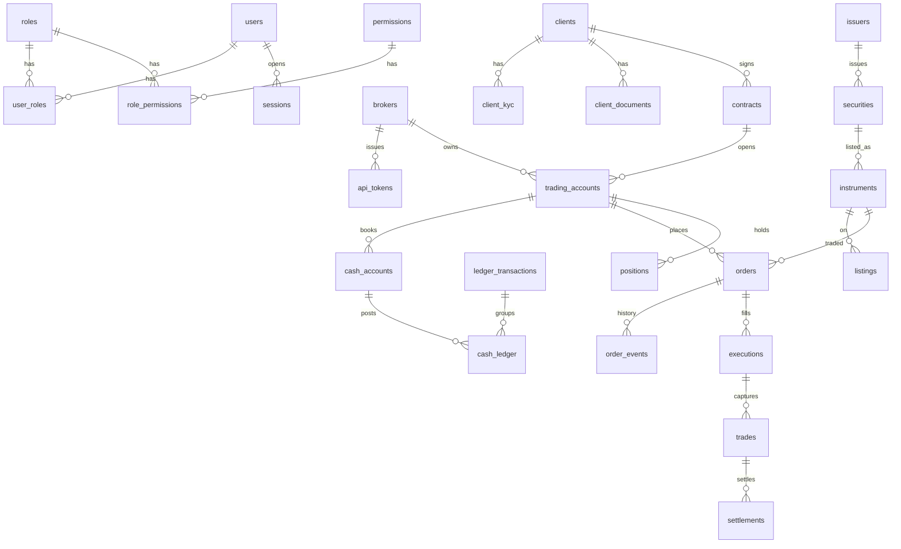

# Entity-Relationship (logical)

## Identity

`users`, `roles`, `permissions`, `user_roles`, `role_permissions`, `departments`, `sessions`, `refresh_tokens`, `totp_secrets`, `password_reset_tokens`, `step_up_challenges`, `security_events`

## CRM

`clients` (type: INDIVIDUAL | LEGAL | INSTITUTIONAL | GOVERNMENT)  
`client_individuals`, `client_legal_entities`, `client_beneficiaries`  
`client_kyc`, `client_risk_profiles`, `kyc_reviews`  
`aml_rule_sets`, `aml_rules` (configurable)  
`documents` (object storage key, not bytes)

## Legal / books

`contracts`, `trading_accounts`, `cash_accounts`, `ledger_transactions`, `cash_ledger`  
`deposits`, `withdrawals`, `payments`, `approval_requests`, `approval_decisions`

## Market

`exchanges`, `issuers`, `securities`, `instruments`, `listings`  
`market_snapshots`, `order_book_levels`, `market_bars`

## Trading

`orders`, `order_events`, `executions`, `trades`, `positions`, `position_events`  
`risk_limits`, `idempotency_keys`

## Post-trade / money

`settlements`, `tariff_plans`, `commission_tiers`, `commissions`, `corporate_actions`

## Integrations / control

`adapters`, `adapter_sessions`, `outbox_events`  
`reconciliation_jobs`, `reconciliation_items`  
`notifications`, `report_definitions`, `report_runs`  
`audit_logs`, `api_logs`, `error_logs`, `business_events`  
`system_settings`, `currencies`, `organization_policies`
